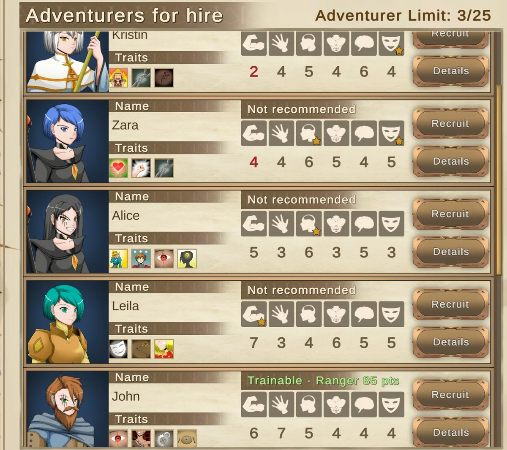
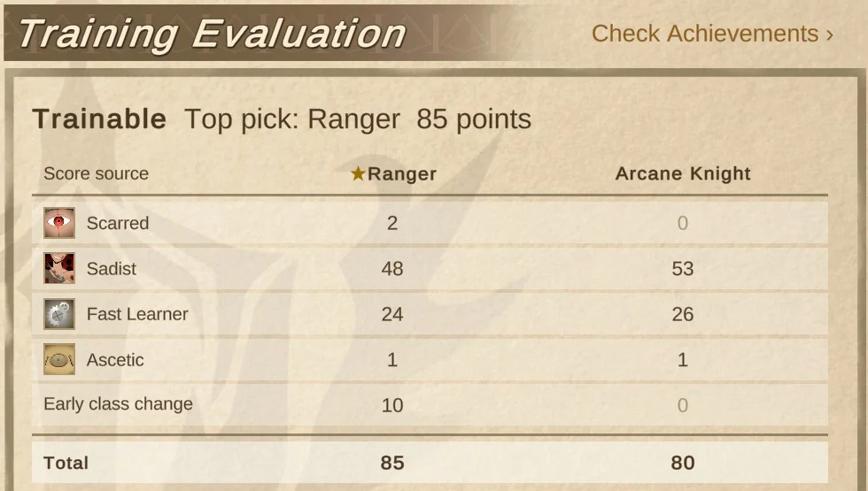
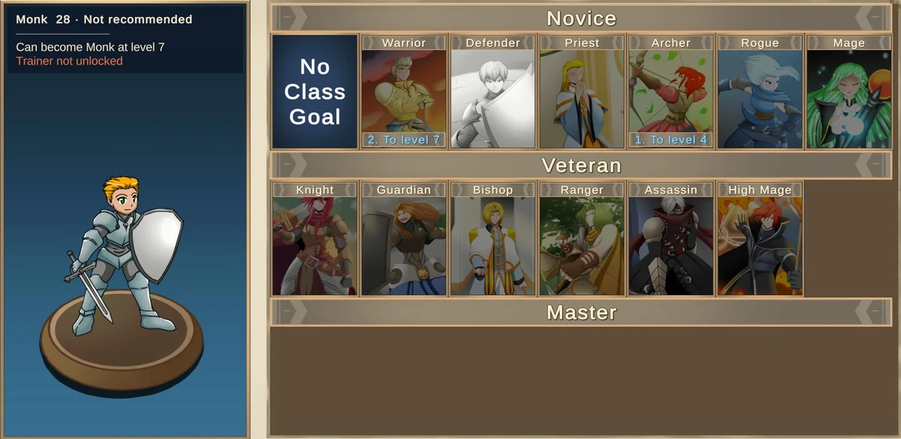

# OAG Score

An unofficial training evaluation mod for [Our Adventurer Guild](https://store.steampowered.com/app/2026000/). It tells you in-game what each adventurer should train, whether they are worth recruiting and when they can change class.

**[Download the latest release](https://github.com/xiaofeng-518/oag-score/releases/latest)** · [Mod page](https://oag.ludbase.com/en/mod/) · [中文介绍](https://oag.ludbase.com/mod/)

## Install

Extract the whole ZIP anywhere and double-click `Install.bat`. It finds the Steam game folder by itself. Windows may warn that the script is unsigned: click "More info", then "Run anyway". `Uninstall.bat` removes it again. See `README.txt` in the download for details.

## Good to know

- Base game 1.7 only. DLC classes are not scored.
- English and Simplified Chinese only.
- Scores reflect the author's preferences, not objective strength.
- This repository only hosts releases and takes bug reports. It does not contain the source code.
- Not affiliated with the game's developer or publisher. Parts of the mod were written with AI assistance.

Found a wrong score or a bug? [Open an issue](https://github.com/xiaofeng-518/oag-score/issues).
